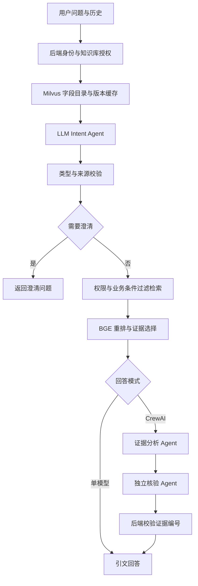

# DocuThinker · 实际架构

平台使用 Python/FastAPI 提供 API，原生 JavaScript 提供浏览器界面，结合 MinerU、MinIO、Milvus、LangGraph 和 CrewAI 完成文档处理与问答。当前应用版本为 5.0，存储 Schema 为 v3。

LangGraph 管理有状态节点和条件分支；CrewAI 在 `crew_review` 节点内组织两个顺序任务。它们是可切换的实验流程，不声明比单模型更准确。Agent 均无文件、Shell、外网搜索工具；内存只属于当前请求。两个角色可使用同一内部模型，“独立核验”指不同任务和职责，不意味着统计独立或保证正确。

## Metadata 自动化

1. MinerU pipeline 解析 PDF，保存 Markdown、JSON、图片到 MinIO。
2. LangChain 分页切片；Metadata Agent 分批读取所有切片，提取自定义业务 key、字段说明、值和逐值原文证据。
3. 后端验证属性名、类型、数量与原文引用。业务值统一存为字符串数组；未知值不编造。
4. Embedding 与 metadata/attributes 一起写入新 Milvus revision。`metadata.field_definitions` 同时保存字段说明；历史 v4 记录可从对应 SQLite provenance 补全说明。
5. 新向量写入、flush、数量校验成功后，SQLite 原子切换活动 revision。失败仍保留旧版本。
6. 查询前根据 `describe_collection` 核对实际结构，批量查询每份活动文档的第一个 chunk，读取实际 Milvus JSON 元数据。此平台文档级属性在所有 chunk 上一致；不适用于任意外部集合的 chunk 级属性，需要另写适配器。
7. 每批最多 128 份文档，读取列不包含向量和正文，不对整个向量集合做抽样。页码、section 等 chunk 局部字段不加入文档级过滤目录。
8. 缓存按 owner、知识库、文档 revision 和字段说明指纹隔离，默认 60 秒、最多 64 个条目；每次命中仍检查授权。发布、重新索引、回滚或文档集合变化自动改变指纹。外部直接写 Milvus 的变化在 TTL 到期或手动刷新后可见。

Milvus 集合缺少当前 revision 时，字段目录读取失败，不用不一致的 SQLite 值伪装成功。升级前请在原版本完成 v1/v2 文档重新索引；新版仅查询 v3 活动修订。

## Prompt 和过滤编译

`app/prompts/classify_intent.txt` 是固定系统规则；`app/classify_intent.py` 每次动态构建 query、chat_history、user_context、metadata_schema、current_time、categories 和 output_schema。

输出 `intent / confidence / semantic_query / filters`，另含澄清标志。为兼容旧客户端也接受 `search_query`；API 计划同时返回两个同义字段。过滤条件仍采用 `field/operator/values` 列表，支持运行时出现的新字段，不把 department/doc_type/version 写成默认业务路由。

`build_filter_expression()` 只生成业务条件，实际执行时由 VectorIndex 强制附加后端 owner、kb、doc、revision 条件。字段必须来自本次授权 Schema，运算符按类型白名单校验，所有字面值用 JSON 编码。模型没有改变 ACL 的能力。

## 权限和失败行为

- 权限基于登录账号拥有知识库。部门只是解释“我们部门”的上下文，尚未实现共享知识库或组织 RBAC。
- 对话历史由客户端提供并限长，只作为数据；不能成为身份或权限依据。
- Intent 调用/校验失败：明确显示 semantic-fallback，保留手动条件和强制权限范围。
- 已验证业务条件无命中：不自动放宽。
- 低置信度/歧义：返回澄清，跳过检索。
- CrewAI 核验不足：返回 insufficient；异常或编号非法：review_failed，不发布未核验草稿。
- 引用存在性校验不能证明语义一定正确，真实模型质量需要目标资料评测。

## 实现定位

| 功能 | 文件 |
|---|---|
| 自动发现字段 | app/metadata_agent.py、app/prompts/discover_metadata.txt |
| Milvus 字段读取/缓存 | app/services.py · metadata_documents、app/metadata_catalog.py |
| Intent 输入和过滤入口 | app/classify_intent.py |
| 意图路由、错误处理 | app/intent.py |
| 动态条件编译 | app/field_schema.py |
| LangGraph 编排 | app/graphs.py、app/indexing.py |
| CrewAI 角色、预算、核验 | app/crew_agents.py、app/prompts/evidence_*.txt |
| API 与鉴权 | app/main.py、app/db.py |
| 前端选择、流程轨迹 | app/static/index.html、app/static/app.js |

官方接口参考：[Milvus 2.5 Query](https://milvus.io/docs/v2.5.x/get-and-scalar-query.md)、[LangGraph Graph API](https://docs.langchain.com/oss/python/langgraph/graph-api)、[CrewAI 自定义 LLM](https://docs.crewai.com/en/learn/custom-llm)、[CrewAI Tasks](https://docs.crewai.com/en/concepts/tasks)。依赖版本见 requirements.txt。
